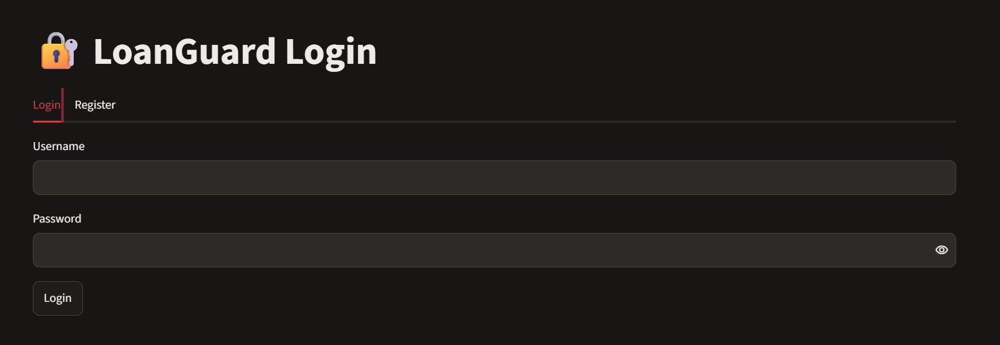
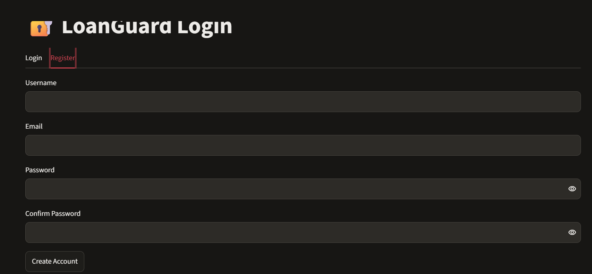
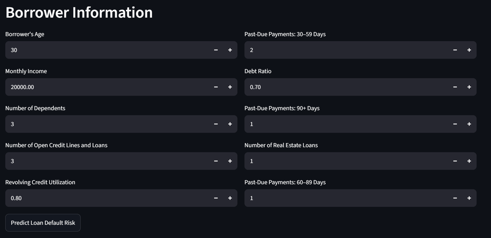
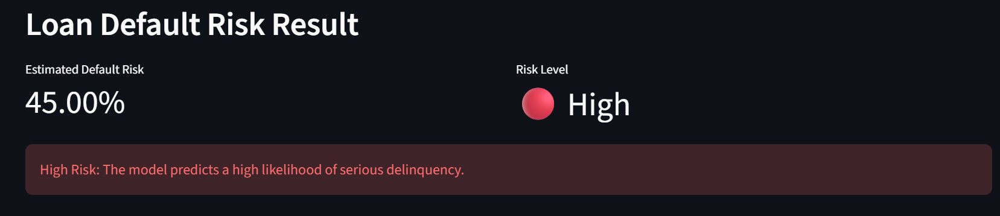
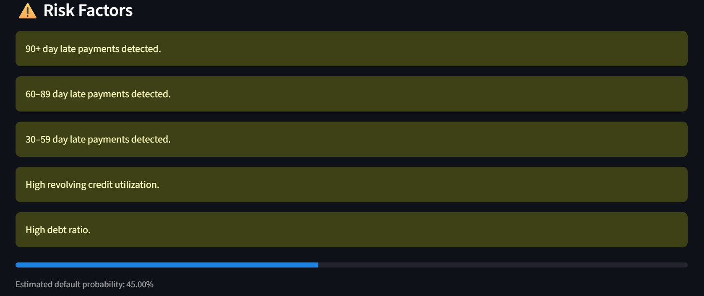
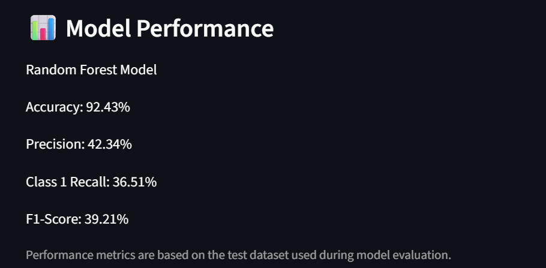

# 💰 Loan Default Prediction & Credit Risk Analysis

## 📌 Project Overview

**Loan Default Prediction & Credit Risk Analysis (LoanGuard)** is a machine learning and fintech application that predicts the likelihood of serious loan delinquency based on a borrower's financial and credit-related information.

The system uses machine learning to analyze borrower information and provides:

- Estimated default probability
- Risk level classification
- Risk factors
- Model performance metrics
- Interactive Streamlit-based prediction interface
- User registration and login
- Secure password hashing
- PostgreSQL-based user authentication

The project uses the **Give Me Some Credit** dataset and demonstrates an end-to-end machine learning workflow for a real-world credit-risk use case.

---

## 🎯 Objectives

- Predict the likelihood of loan default.
- Analyze borrower financial and credit information.
- Compare different machine learning classification models.
- Handle class imbalance in credit-risk data.
- Evaluate model performance using appropriate classification metrics.
- Build an interactive web application for loan risk prediction.
- Implement secure user authentication.
- Deploy the application to the cloud.
- Demonstrate the use of machine learning in a fintech application.

---

## 📊 Dataset

The project uses the **Give Me Some Credit** dataset.

### Dataset Information

- **Total records:** 150,000
- **Number of columns:** 12
- **Target variable:** `SeriousDlqin2yrs`

### Target Variable

| Value | Meaning |
|---|---|
| `0` | No serious delinquency |
| `1` | Serious delinquency |

The dataset is highly imbalanced:

- **Class 0:** ~93.32%
- **Class 1:** ~6.68%

### Features

The model uses borrower features such as:

- Revolving utilization of unsecured lines
- Age
- Number of times 30–59 days past due
- Debt ratio
- Monthly income
- Number of open credit lines and loans
- Number of times 90+ days late
- Number of real estate loans or lines
- Number of times 60–89 days past due
- Number of dependents

---

## 🧹 Data Preprocessing

The following preprocessing steps are performed:

1. Removed the unnecessary index column.
2. Separated features and target variable.
3. Split the dataset into training and testing sets.
4. Used stratified sampling to maintain class distribution.
5. Handled missing values using median imputation.
6. Applied feature scaling for Logistic Regression.
7. Used balanced class weights to improve handling of the minority default class.

---

## 🤖 Machine Learning Models

Two classification algorithms were implemented and evaluated.

### 1. Logistic Regression

Logistic Regression was used as a baseline classification model.

The pipeline includes:

- Median imputation
- StandardScaler
- Logistic Regression
- Balanced class weights

### 2. Random Forest

Random Forest was implemented as the primary prediction model used by the Streamlit application.

Configuration includes:

- 100 decision trees
- Balanced class weights
- Random state = 42
- Parallel processing

The Random Forest model was selected for the deployed application based on its overall performance.

---

## 📈 Model Performance

The Random Forest model achieved the following results on the test dataset:

| Metric | Score |
|---|---:|
| Accuracy | **92.43%** |
| Precision | **42.34%** |
| Class 1 Recall | **36.51%** |
| F1-Score | **39.21%** |

Because the dataset is highly imbalanced, accuracy alone is not sufficient to evaluate the model.

Therefore, **precision, recall, and F1-score for the default class (Class 1)** are also considered.

### Metric Interpretation

- **Accuracy:** Percentage of all predictions that were correct.
- **Precision:** Among borrowers predicted as defaulters, the percentage who were actually defaulters.
- **Recall:** Among actual defaulters, the percentage correctly identified by the model.
- **F1-Score:** Harmonic balance between precision and recall.

---

## 🌐 Streamlit Application

The project includes an interactive **Streamlit** web application.

Users can create an account, log in, enter borrower information, and receive a loan default risk prediction.

### Authentication

The application provides:

- User registration
- User login
- Logout functionality
- Password confirmation
- Password-strength validation
- Secure password hashing using **bcrypt**

Passwords are never stored as plain text.

### Borrower Information

The application accepts:

- Borrower's age
- Monthly income
- Number of dependents
- Number of open credit lines and loans
- Revolving credit utilization
- 30–59 day late payments
- Debt ratio
- 90+ day late payments
- Number of real estate loans
- 60–89 day late payments

### Prediction Output

The application displays:

- Estimated default probability
- Risk level
- Risk factors
- Probability progress bar
- Model performance metrics

### Risk Classification

| Default Probability | Risk Level |
|---|---|
| Below 10% | 🟢 Low |
| 10% – 29.99% | 🟠 Medium |
| 30% or above | 🔴 High |

---

## 🔐 Security & Database

The authentication system uses **PostgreSQL** for storing user account information.

### Database

- **PostgreSQL** – Production database
- **Neon** – Cloud PostgreSQL provider
- **bcrypt** – Password hashing
- **python-dotenv** – Environment variable management

The database stores:

- User ID
- Username
- Email
- Bcrypt password hash

Sensitive database credentials are stored using the `DATABASE_URL` environment variable and are not included in the GitHub repository.

The `.env` file is excluded using `.gitignore`.

---

## ☁️ Deployment

The LoanGuard application is deployed using **Render**.

### Deployment Architecture

```text
User
  ↓
LoanGuard Streamlit Application
  ↓
Render
  ↓
PostgreSQL Connection
  ↓
Neon PostgreSQL
  ↓
Users Table
```

The deployed application uses the `DATABASE_URL` environment variable to securely connect to the Neon PostgreSQL database.

The machine learning model is loaded by the Streamlit application and used for real-time borrower risk prediction.

---

## 📸 Application Screenshots

### 1. Login

Users can securely log in to their LoanGuard account.



### 2. Registration

New users can create an account with password validation.



### 3. Borrower Information

The application provides a two-column interface for entering borrower financial and credit information.



### 4. Loan Default Risk Result

The system displays the estimated default probability and corresponding risk level.



### 5. Risk Factors

The application identifies important risk factors based on the information entered by the user.



### 6. Model Performance

The application displays the Random Forest model's evaluation metrics.



---

## 📁 Project Structure

```text
loan-predict/
│
├── data/
│   └── cs-training.csv
│
├── models/
│   ├── loan_default_model.pkl
│   └── model_metrics.pkl
│
├── screenshots/
│   ├── borrower-info.png
│   ├── login.png
│   ├── model-performance.png
│   ├── register.png
│   ├── risk-factors.png
│   └── risk-result.png
│
├── src/
│   ├── data_analysis.py
│   ├── load_real_data.py
│   ├── prepare_data.py
│   └── train_model.py
│
├── app.py
├── auth.py
├── requirements.txt
├── .gitignore
└── readme.md
```

### File Description

**`app.py`**  
Contains the Streamlit application for user authentication, borrower input, and loan default risk prediction.

**`auth.py`**  
Handles user registration, login authentication, password hashing, and PostgreSQL database communication.

**`src/data_analysis.py`**  
Performs exploratory data analysis.

**`src/load_real_data.py`**  
Loads the real loan dataset.

**`src/prepare_data.py`**  
Handles data preparation, train-test splitting, and missing-value handling.

**`src/train_model.py`**  
Trains and evaluates the machine learning models.

**`models/loan_default_model.pkl`**  
Saved Random Forest model used by the application.

**`models/model_metrics.pkl`**  
Stores model performance metrics displayed in the Streamlit application.

**`requirements.txt`**  
Contains the Python libraries required to run the project.

**`.gitignore`**  
Prevents sensitive files, virtual environments, local databases, and other unnecessary files from being committed to GitHub.

---

## 🛠️ Technologies Used

### Programming & Data Science

- **Python**
- **Pandas** – Data manipulation and analysis
- **NumPy** – Numerical operations
- **Scikit-learn** – Machine learning and model evaluation
- **Matplotlib** – Data visualization
- **Seaborn** – Data visualization
- **Joblib** – Model saving and loading

### Application

- **Streamlit** – Interactive web application
- **bcrypt** – Secure password hashing

### Database

- **PostgreSQL** – User authentication database
- **Neon** – Cloud PostgreSQL database
- **python-dotenv** – Environment variable management
- **psycopg** – PostgreSQL connection

### Deployment & Version Control

- **Render** – Cloud deployment
- **Git**
- **GitHub**

---

## ▶️ How to Run the Project

### 1. Clone the repository

```bash
git clone YOUR_GITHUB_REPOSITORY_URL
```

### 2. Navigate to the project directory

```bash
cd loan-default-prediction
```

### 3. Create a virtual environment

```bash
python -m venv .venv
```

### 4. Activate the virtual environment

For Windows:

```bash
.venv\Scripts\activate
```

### 5. Install dependencies

```bash
pip install -r requirements.txt
```

### 6. Configure the database

Create a `.env` file in the project root:

```text
DATABASE_URL=YOUR_NEON_POSTGRESQL_CONNECTION_STRING
```

Do not commit the `.env` file to GitHub.

### 7. Run the Streamlit application

```bash
streamlit run app.py
```

The Streamlit application will open in your browser.

---

## 🔄 Machine Learning Workflow

```text
Dataset
   ↓
Data Analysis
   ↓
Data Preprocessing
   ↓
Train-Test Split
   ↓
Missing Value Handling
   ↓
Model Training
   ↓
Model Evaluation
   ↓
Random Forest Selection
   ↓
Model Saving
   ↓
Streamlit Application
   ↓
Loan Default Risk Prediction
```

---

## 🔄 Application Workflow

```text
User Registration
       ↓
Secure Password